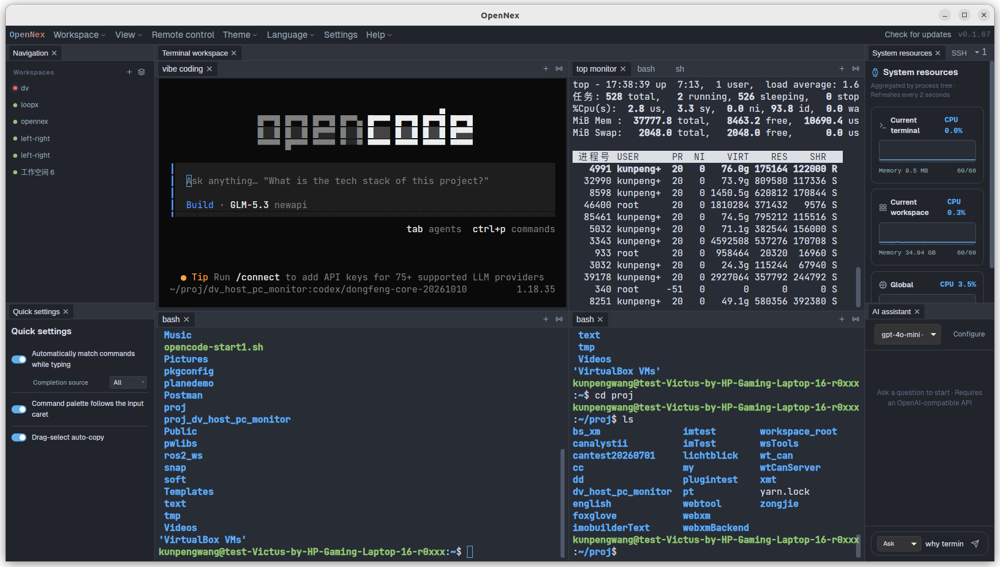
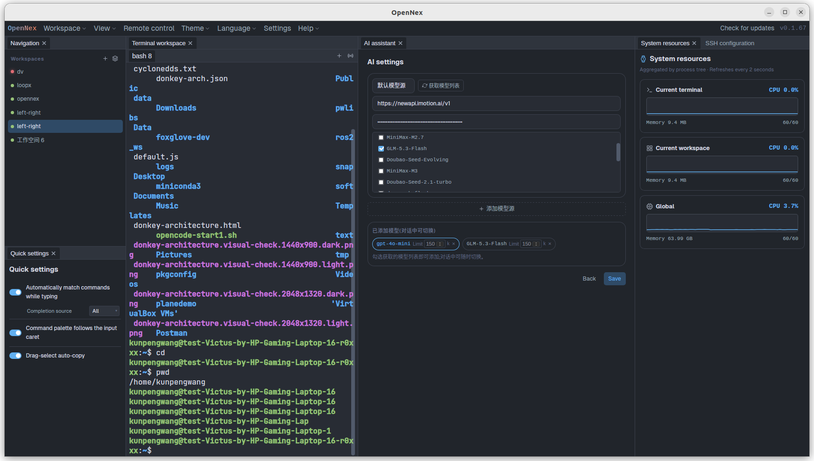
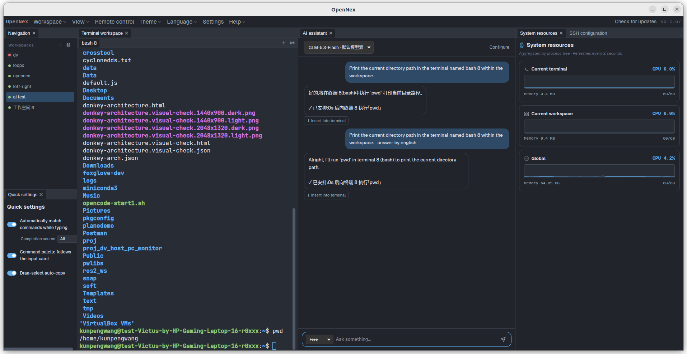
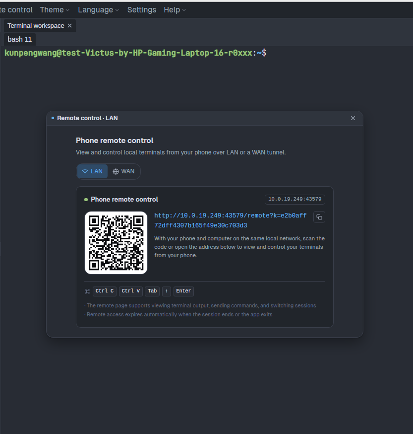
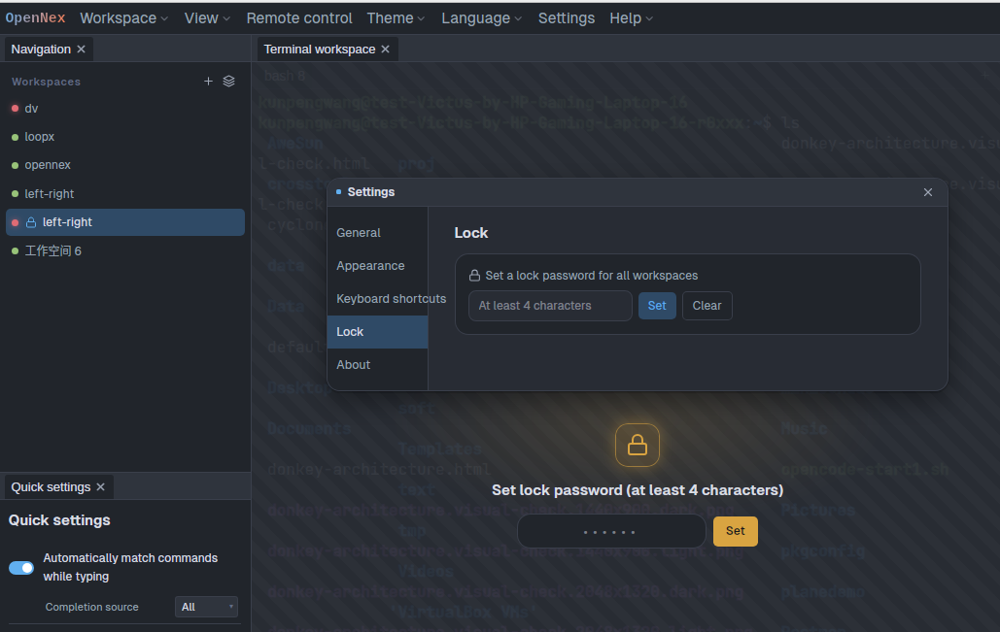
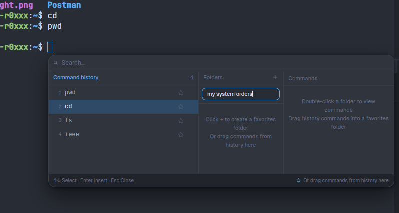
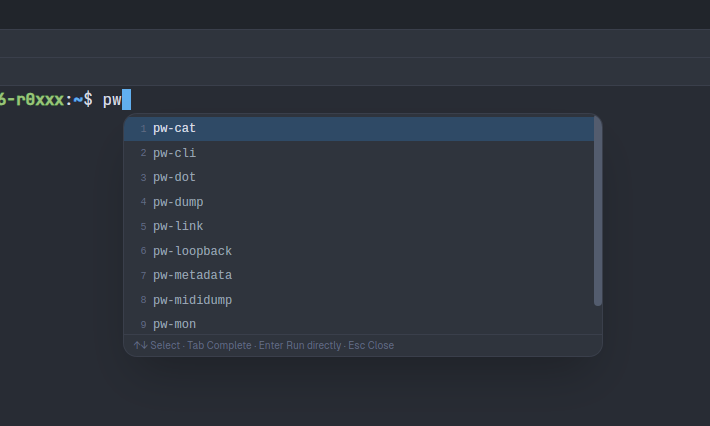
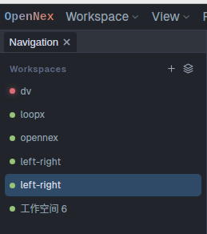

[简体中文](README.md) | [English](README.en.md) | [繁體中文](README.zh-TW.md) | [Deutsch](README.de.md) | [Français](README.fr.md) | [日本語](README.ja.md) | [Italiano](README.it.md) | [한국어](README.ko.md) | **हिन्दी**

# OpenNex

OpenNex — **मल्टी-विंडो स्टैक्ड AI टर्मिनल मैनेजर** — किसी भी AI कोडिंग या एजेंट टूल को मल्टी-इंस्टेंस, रिमोट-कंट्रोल योग्य स्मार्ट वर्कस्टेशन में बदल देता है।



| | |
|---|---|
| **1000+** | समानांतर सक्रिय विंडो |
| **20+** | UI भाषाएँ |
| **3** | नेटिव प्लेटफ़ॉर्म (Linux / Windows / macOS) |

## स्क्रीनशॉट

**🤖 AI असिस्टेंट · मॉडल कॉन्फ़िगरेशन**



AI असिस्टेंट सक्रिय करने के लिए मॉडल API और कॉन्टेक्स्ट सीमा कॉन्फ़िगर करें।

**🤖 AI असिस्टेंट · बातचीत से टर्मिनल नियंत्रण**



मॉडल API कॉन्फ़िगर होने पर बस बातचीत से AI को टर्मिनल में कमांड चलाने या समस्या जाँचने के लिए कहें — हर समय हस्तक्षेप संभव।

**🌐 रिमोट कंट्रोल सहायक**



QR कोड स्कैन करें या ब्राउज़र से जुड़कर टर्मिनल दूर से चलाएँ; टर्मिनल से शुरू किए गए सॉफ़्टवेयर भी रिमोट-कंट्रोल योग्य।

**🔒 वर्कस्पेस लॉक**



अनुपस्थिति में वन-क्लिक लॉक, लौटते ही तेज़ी से अनलॉक।

**★ कमांड पसंदीदा**



बार-बार उपयोग के कमांड फ़ोल्डर में सहेजें, जल्दी बुलाएँ।

**↩ कमांड ऑटो-पूर्णता**



टाइप करते ही मैच: सिस्टम कमांड + इस टर्मिनल का इतिहास।

**◉ निष्क्रिय/व्यस्त संकेतक**



लाल = वर्कस्पेस में कोई टर्मिनल अभी व्यस्त है; हरा = सब पूर्ण।

## मुख्य विशेषताएँ

**✦ AI स्वतः निष्पादन**
AI स्वयं टर्मिनल कार्यों की योजना बनाकर निष्पादित करता है — बीच में रोका/रुकवाया जा सकता है।

**🌐 WAN रिमोट कंट्रोल**
LAN से बाहर फ़ोन, टैबलेट, PC से टर्मिनल सत्र दूर से चलाएँ।

**▦ लचीला विंडो लेआउट**
विंडो आज़ादी से व्यवस्थित/स्टैक करें; लेआउट सहेजें और पुनः लोड करें।

**↩ कमांड इतिहास**
हर कमांड असीमित रूप से रिकॉर्ड; एक कीस्ट्रोक से पुनः प्राप्त करें।

**★ पसंदीदा**
बार-बार उपयोग होने वाले कमांड एक क्लिक में।

**◈ थीम**
कस्टम थीम से अपना टर्मिनल लुक।

**🔒 वर्कस्पेस एन्क्रिप्शन**
मास्टर-पासवर्ड लॉक और एन्क्रिप्टेड वर्कस्पेस।

**⇄ LAN रिमोट कंट्रोल**
उसी LAN पर किसी भी डिवाइस से टर्मिनल सत्र चलाएँ।

**◉ व्यस्तता पहचान**
हर वर्कस्पेस की लाइव स्थिति एक नज़र में।

**⇅ SSH होस्ट**
SSH होस्ट प्रबंधन निर्मित — रिमोट सर्वर वन-क्लिक पहुँच।

**⚡ परफ़ॉर्मेंस मॉनिटरिंग**
विंडो और सिस्टम संसाधनों की लाइव निगरानी।

**⟲ वर्कस्पेस मेमोरी**
स्थिति अपने आप सहेजी जाती है, पुनः आरंभ पर बहाल।

**🖥 सिस्टम जानकारी**
होस्ट सिस्टम जानकारी और संसाधन रीयल-टाइम।

**⤺ पथ पुनर्बहाली**
रीस्टार्ट के बाद वर्किंग डायरेक्टरी अपने आप बहाल।

**🌐 बहुभाषी**
20+ UI भाषाएँ, एक क्लिक में बदलें।

## समर्थित प्लेटफ़ॉर्म

| प्लेटफ़ॉर्म | न्यूनतम | इंस्टॉलेशन |
|------|---------|---------|
| Windows | Windows 10+ | NSIS इंस्टॉलर / MSI |
| macOS | macOS 12+ (Apple Silicon) | DMG |
| Linux | Ubuntu 22.04+ (glibc 2.35+) | deb / AppImage |

सभी इंस्टॉलर यहाँ से: [वेबसाइट](https://opennex.zeadix.com) या [GitHub Releases](https://github.com/zeadix/opennex/releases/latest); ऐप में हस्ताक्षर-सत्यापित वन-क्लिक अपडेट निर्मित है।

## विकास और परीक्षण

```bash
cd tauri-app

# फ्रंटएंड डिपेंडेंसी इंस्टॉल करें (पहली बार)
npm install

# dev मोड: vite हॉट रीलोड + Rust डिबग बिल्ड (या ./dev.sh)
npm run tauri dev

# फ्रंटएंड टाइपचेक / प्रोडक्शन बिल्ड
npx tsc --noEmit
npm run build

# पैकेज (वर्तमान प्लेटफ़ॉर्म)
npm run tauri build
```

### CI/CD

`v*.*.*` प्रारूप का टैग push करते ही GitHub Actions चलता है: बहु-प्लेटफ़ॉर्म पैकेजिंग (NSIS+MSI / DMG / DEB+AppImage), minisign-हस्ताक्षरित अपडेट पैकेज, अपडेट फ़ीड `tauri/latest.json` का R2 पर अपलोड, GitHub Release, और वेबसाइट रीबिल्ड:

```bash
git tag v0.2.0
git push origin v0.2.0
```

## प्रोजेक्ट संरचना

```
opennex/
├── .github/workflows/
│   ├── release.yml                # release: multi-platform build + signing + R2 + updater feed + GitHub Release
│   └── rebuild-updater-feed.yml   # manual tool: rebuild the updater feed from R2 (fix without a release)
├── assets/icon/                   # app icon source
├── tauri-app/                     # Tauri client (the actively developed line)
│   ├── src/                       # React + TypeScript frontend (xterm.js terminal)
│   ├── src-tauri/                 # Tauri 2 Rust backend (PTY / history / AI proxy / updater)
│   └── dev.sh                     # one-shot dev launcher (vite + cargo run)
└── research/                      # research & audit notes
```

## License

MIT